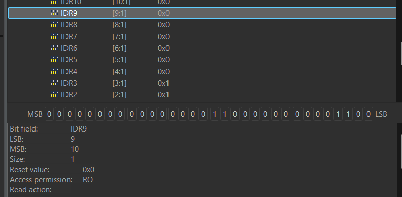
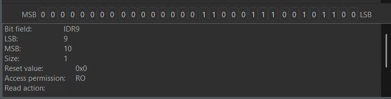
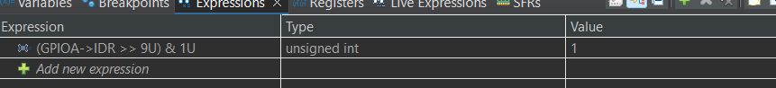

# P01 — Lectura digital de PA9, GPIO e inspección de registros

## Objetivo

Leer una **señal externa conectada físicamente a PA9** mediante polling y utilizar su estado para controlar el LED LD2 de **PA5**. Verificar la lectura en las vistas **Variables**, **SFRs** y **Expressions** de STM32CubeIDE.

## Hardware y configuración

| Elemento | Valor |
| --- | --- |
| MCU | STM32F411RET6 (NUCLEO-F411RE) |
| Entrada | **PA9** — señal externa; entrada con pull-up, según prueba |
| Salida | **PA5** — LED integrado LD2 |
| Programador | ST-LINK/SWD |
| Tipo de señal externa | Pendiente de detallar: pulsador u otra fuente; documentar tensión y conexión |

> Este laboratorio usa **PA9**, no el botón integrado B1 de PC13. Si se emplea un pulsador hacia GND con pull-up, libre = HIGH y presionado = LOW. No se ha documentado aún el diagrama exacto del circuito externo.

## Funcionamiento del código

Fragmento de referencia de la lógica de polling (confirmar contra el archivo `main.c` real antes de afirmar que coincide exactamente):

```c
GPIO_PinState estado_pa9 = HAL_GPIO_ReadPin(GPIOA, GPIO_PIN_9);

if (estado_pa9 == GPIO_PIN_SET) {
    HAL_GPIO_WritePin(GPIOA, GPIO_PIN_5, GPIO_PIN_SET);
} else {
    HAL_GPIO_WritePin(GPIOA, GPIO_PIN_5, GPIO_PIN_RESET);
}
```

En **polling**, el programa consulta reiteradamente el pin en su bucle principal; no usa interrupción del GPIO para detectar cambios. Una espera adicional de 10 ms se usó como propuesta didáctica; confirmar si está en el firmware ejecutado.

## Registro estudiado: GPIOA_IDR

De acuerdo con el Reference Manual **RM0383**, el registro de datos de entrada `GPIOx_IDR` tiene offset `0x10`.

| Propiedad | Valor |
| --- | --- |
| Base GPIOA | `0x40020000` |
| Dirección GPIOA_IDR | `0x40020010` |
| Bit PA9 | `IDR9`, posición 9 |
| Acceso | Lectura (`RO`) |

Para aislar solo el estado de PA9 se evaluó:

```c
(GPIOA->IDR >> 9U) & 1U
```

- `GPIOA->IDR`: lee el registro mapeado en memoria del puerto A (`->` accede al miembro de la estructura a través de un puntero).
- `>> 9U`: desplaza 9 posiciones a la derecha; `U` indica literal `unsigned int`.
- `& 1U`: AND bit a bit con la máscara 1; elimina otros bits y deja 0 o 1.
- `GPIO_PIN_SET` y `GPIO_PIN_RESET` expresan los estados que devuelve `HAL_GPIO_ReadPin`.

## Evidencia de depuración real

### PA9 en LOW



**Observado:** `IDR9 = 0x0`.

### PA9 en HIGH



**Observado:** el bit IDR9 cambia respecto a la captura anterior; se verificó el nivel alto.

### Evaluación de la expresión



**Observado:** la expresión `(GPIOA->IDR >> 9U) & 1U` devuelve `1`.

## Resultados y alcance

| Comprobación | Resultado |
| --- | --- |
| Lectura de PA9 en bajo | Confirmada en SFRs |
| Lectura de PA9 en alto | Confirmada en SFRs y Expressions |
| Cambio del LED PA5 en función de PA9 | Confirmado por el autor de la práctica |
| Medición con osciloscopio | No realizada/documentada |
| Prueba de antirrebote | No realizada/documentada |

**No confundir:** este laboratorio usa HAL para la lectura/control en el ejemplo de aplicación, y **acceso de solo lectura a registros** para analizar el GPIO durante la depuración. La inicialización y control enteramente por registros serán materia de P02.

## Herramientas aprendidas

- **Variables:** inspección de variables C al detener el firmware.
- **SFRs:** lectura de los registros del periférico, como `GPIOA_IDR`.
- **Expressions:** evaluación de expresiones C en un punto de depuración.

## Referencias oficiales

- [STM32F411RE — Datasheet DS10314](https://www.st.com/resource/en/datasheet/stm32f411re.pdf)
- [STM32F411 — Reference Manual RM0383 y documentación](https://www.st.com/en/microcontrollers-microprocessors/stm32f411/documentation.html) — GPIO input data register, offset `0x10`.
- [NUCLEO-64 — UM1724](https://www.st.com/resource/en/user_manual/dm00105823.pdf)

## Código fuente

> Copiar el proyecto STM32CubeIDE realmente probado dentro de `firmware/`. Confirmar contenido exacto de `main.c`, configuración de pull-up y versión HAL al hacerlo.
